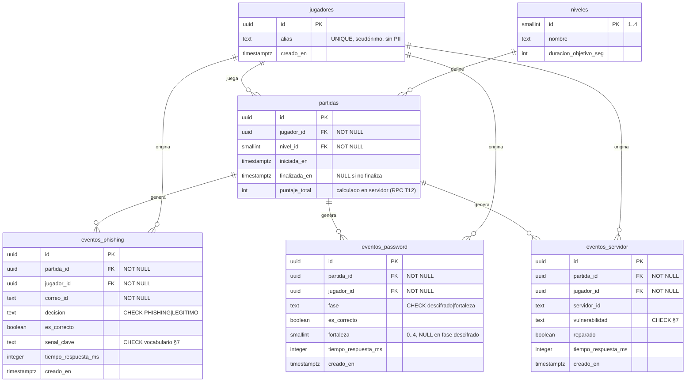

# Modelo de Dominio — CyberGuard: Misión Ciberseguridad

> **Tarea:** T02 (`analista-dominio`) — entregable parcial integrado.
> **Fecha:** 2026-10-16 · **Estado:** Propuesto (pendiente Gate C2 del Guardián).
> **Fuentes:** `doc/plan/00-plan-maestro.md` (§3, §4.2, §4.3, §8), `doc/plan/01-desglose-tareas.md` (T02, T11, T12, T41).
> **Consumidores:** `arquitecto` (T03), `constructor` (`codigo/database/schema.sql` — T11, `rls.sql` — T12, `views.sql` — T41), `diseñador` (T04).

---

## 1. Principios del modelo

| # | Principio | Origen |
|---|---|---|
| 1 | **Sin PII**: solo `jugador_id uuid` + `alias` seudónimo. Nunca nombre real, correo, teléfono, IP ni fecha de nacimiento. | Contrato CyberGuard §3.3; plan §4.2 |
| 2 | **Append-only**: las tablas `eventos_*` admiten solo `INSERT` desde el cliente (RLS). Sin `UPDATE`/`DELETE`. | Contrato CyberGuard §3.4; plan §4.2 |
| 3 | **Sin ranking** (decisión 3a, §8): no existen entidades ni vistas de ranking/leaderboard. Solo métricas agregadas en Looker. | Plan §3.4, §4.3 |
| 4 | **1 evento = 1 decisión del jugador** (granularidad fina, ver §5). | T02 — criterio de aceptación |
| 5 | **El cliente escribe decisiones; el servidor calcula el puntaje**. `puntaje_total` se valida en RPC (T12), nunca se confía en el cliente. | Contrato CyberGuard §3.4; plan §3.4 |
| 6 | **Nunca** se almacena texto de contraseña: solo métricas de complejidad (`fortaleza` 0–4). | Contrato CyberGuard / analista §3.1 |
| 7 | Todo evento lleva `partida_id` + `jugador_id` FK `NOT NULL` y `creado_en timestamptz default now()`. | Contrato CyberGuard §3.4 |

---

## 2. Diagrama entidad-relación (Mermaid)



> **Nota T11:** `id uuid default gen_random_uuid()` y `creado_en timestamptz default now()` se generan **en servidor**; el cliente no los envía. El `nivel` de un evento se deriva por `partida_id → partidas.nivel_id` (sin duplicar columnas).

---

## 3. Entidades

### 3.1 `jugadores` — identidad seudónima

| Columna | Tipo | Restricciones | Descripción |
|---|---|---|---|
| `id` | `uuid` | PK, `default gen_random_uuid()` | Identificador del jugador. Generado en servidor. |
| `alias` | `text` | `UNIQUE NOT NULL` | Seudónimo generado por el cliente (p. ej. `agente-azul-42`). **Sin PII**: proibido usar nombres reales o correos. |
| `creado_en` | `timestamptz` | `default now()` | Alta de la identidad. |

- El cliente conserva `jugador_id` + `alias` en `user://perfil_jugador.json` para continuidad entre sesiones (ver T03, `GameState`).
- Si el alias ya existe (`409`), el cliente regenera otro; no hay login ni contraseña.

### 3.2 `niveles` — catálogo de misiones

| Columna | Tipo | Restricciones | Descripción |
|---|---|---|---|
| `id` | `smallint` | PK | 1..4 (ver `doc/diseno/01-misiones.md`, T04). |
| `nombre` | `text` | `NOT NULL` | Nombre visible ("Onboarding", "Bandeja peligrosa", …). |
| `duracion_objetivo_seg` | `int` | `NOT NULL` | Duración objetivo del nivel (300–480 s, rango 5–8 min decidido en §8). |

- Se pobla con `seed.sql` (T13). Es un catálogo, no contenido jugable (el contenido vive en `codigo/game/data/*.json`).

### 3.3 `partidas` — sesión de juego

| Columna | Tipo | Restricciones | Descripción |
|---|---|---|---|
| `id` | `uuid` | PK, `default gen_random_uuid()` | Identificador de la partida. |
| `jugador_id` | `uuid` | FK `jugadores.id`, `NOT NULL` | Jugador dueño de la partida. |
| `nivel_id` | `smallint` | FK `niveles.id`, `NOT NULL` | Nivel jugado. |
| `iniciada_en` | `timestamptz` | `default now()` | Inicio (se corresponde con el evento de dominio `partida_iniciada`). |
| `finalizada_en` | `timestamptz` | nullable | Fin real; `NULL` si el jugador abandonó o el temporizador no cerró la partida. |
| `puntaje_total` | `int` | nullable | **Calculado en servidor** (RPC `calcular_puntaje`, T12). `NULL` hasta que el servidor lo valida. El cliente nunca lo escribe. |

### 3.4 `eventos_phishing` — una fila por clasificación de correo

| Columna | Tipo | Restricciones | Descripción |
|---|---|---|---|
| `id` | `uuid` | PK, `default gen_random_uuid()` | ID de evento (servidor). |
| `partida_id` | `uuid` | FK `partidas.id`, `NOT NULL` | Partida en la que ocurrió. |
| `jugador_id` | `uuid` | FK `jugadores.id`, `NOT NULL` | Denormalizado a propósito (consulta directa en Looker sin join). |
| `correo_id` | `text` | `NOT NULL` | ID estable del correo en `data/*.json` (p. ej. `n1_c01`). **No** contenido ni remitente real. |
| `decision` | `text` | `CHECK (decision IN ('PHISHING','LEGITIMO'))`, `NOT NULL` | Clasificación elegida por el jugador. |
| `es_correcto` | `boolean` | `NOT NULL` | `true` si la decisión coincide con la respuesta esperada del JSON de nivel. |
| `senal_clave` | `text` | `CHECK` (§7), `NOT NULL` | Señal clave del correo evaluado; `'sin_senales'` si el correo es legítimo. |
| `tiempo_respuesta_ms` | `int` | `CHECK (tiempo_respuesta_ms >= 0)`, `NOT NULL` | Medido con `Time.get_ticks_msec()` desde que se abre la carta del correo hasta la decisión. |
| `creado_en` | `timestamptz` | `default now()` | Sello temporal para series de Looker. |

### 3.5 `eventos_password` — una fila por fase de contraseñas

| Columna | Tipo | Restricciones | Descripción |
|---|---|---|---|
| `id` | `uuid` | PK, `default gen_random_uuid()` | ID de evento (servidor). |
| `partida_id` | `uuid` | FK `partidas.id`, `NOT NULL` | Partida. |
| `jugador_id` | `uuid` | FK `jugadores.id`, `NOT NULL` | Jugador. |
| `fase` | `text` | `CHECK (fase IN ('descifrado','fortaleza'))`, `NOT NULL` | Fase del mini-juego: descifrar mensaje (César) o evaluar fortaleza. |
| `es_correcto` | `boolean` | `NOT NULL` | `true` si la clave descifrada / la valoración de fortaleza es correcta. |
| `fortaleza` | `smallint` | `CHECK (fortaleza BETWEEN 0 AND 4)`, nullable | Valor 0–4 (§6). **`NULL` en `fase='descifrado'`** (no aplica). **Nunca** se envía el texto de la contraseña. |
| `tiempo_respuesta_ms` | `int` | `CHECK (>= 0)`, `NOT NULL` | Tiempo de la fase. |
| `creado_en` | `timestamptz` | `default now()` | Sello temporal. |

### 3.6 `eventos_servidor` — una fila por intento de reparación

| Columna | Tipo | Restricciones | Descripción |
|---|---|---|---|
| `id` | `uuid` | PK, `default gen_random_uuid()` | ID de evento (servidor). |
| `partida_id` | `uuid` | FK `partidas.id`, `NOT NULL` | Partida. |
| `jugador_id` | `uuid` | FK `jugadores.id`, `NOT NULL` | Jugador. |
| `servidor_id` | `text` | `NOT NULL` | ID estable del servidor en `data/*.json` (p. ej. `srv_01`). |
| `vulnerabilidad` | `text` | `CHECK` (§7), `NOT NULL` | Vulnerabilidad identificada/reparada. |
| `reparado` | `boolean` | `NOT NULL` | `true` si el jugador aplicó el parche correcto. |
| `tiempo_respuesta_ms` | `int` | `CHECK (>= 0)`, `NOT NULL` | Tiempo desde que abre el panel del servidor hasta reparar/abandonar. |
| `creado_en` | `timestamptz` | `default now()` | Sello temporal. |

---

## 4. Payload EXACTO de telemetría (cliente Godot → Supabase REST)

> **Contrato congelado.** Estos payloads deben coincidir **literalmente** con las columnas de `schema.sql` (T11). Cualquier cambio obliga a actualizar este documento, `schema.sql` y el `constructor`, con revisión del Guardián.
> Headers comunes (detalle completo en `doc/arquitectura/01-arquitectura-godot.md`, T03):
> `apikey: <SUPABASE_ANON_KEY>` · `Authorization: Bearer <SUPABASE_ANON_KEY>` · `Content-Type: application/json` · `Prefer: return=minimal`.
> El `id`, `creado_en` y `puntaje_total` **no** viajan en el payload: los genera el servidor.

### 4.1 Clasificación de phishing

```
POST {SUPABASE_URL}/rest/v1/eventos_phishing
```

```json
{
  "partida_id": "550e8400-e29b-41d4-a716-446655440000",
  "jugador_id": "7c9e6679-7425-40de-944b-e07fc1f90ae7",
  "correo_id": "n1_c01",
  "decision": "PHISHING",
  "es_correcto": true,
  "senal_clave": "dominio_sospechoso",
  "tiempo_respuesta_ms": 12450
}
```

| Campo JSON | Columna SQL | Tipo | Valores |
|---|---|---|---|
| `partida_id` | `partida_id` | `uuid` | UUID de la partida activa |
| `jugador_id` | `jugador_id` | `uuid` | UUID del jugador en sesión |
| `correo_id` | `correo_id` | `text` | ID estable del correo (`n1_c01` …) |
| `decision` | `decision` | `text` | `"PHISHING"` \| `"LEGITIMO"` (literal, sin tilde en el valor) |
| `es_correcto` | `es_correcto` | `boolean` | `true` \| `false` |
| `senal_clave` | `senal_clave` | `text` | Vocabulario §7 |
| `tiempo_respuesta_ms` | `tiempo_respuesta_ms` | `integer` | ≥ 0 |

### 4.2 Contraseñas / descifrado

```
POST {SUPABASE_URL}/rest/v1/eventos_password
```

```json
{
  "partida_id": "550e8400-e29b-41d4-a716-446655440000",
  "jugador_id": "7c9e6679-7425-40de-944b-e07fc1f90ae7",
  "fase": "fortaleza",
  "es_correcto": true,
  "fortaleza": 3,
  "tiempo_respuesta_ms": 8300
}
```

| Campo JSON | Columna SQL | Tipo | Valores |
|---|---|---|---|
| `partida_id` | `partida_id` | `uuid` | UUID de la partida |
| `jugador_id` | `jugador_id` | `uuid` | UUID del jugador |
| `fase` | `fase` | `text` | `"descifrado"` \| `"fortaleza"` |
| `es_correcto` | `es_correcto` | `boolean` | `true` \| `false` |
| `fortaleza` | `fortaleza` | `smallint` (nullable) | Entero 0–4 (§6); **`null` obligatorio en `fase="descifrado"`** |
| `tiempo_respuesta_ms` | `tiempo_respuesta_ms` | `integer` | ≥ 0 |

> **Prohibición absoluta:** el payload **no** contiene el texto de la contraseña ni ninguna derivada reversible del texto (regla auditada por el Guardián).

### 4.3 Reparación de servidores

```
POST {SUPABASE_URL}/rest/v1/eventos_servidor
```

```json
{
  "partida_id": "550e8400-e29b-41d4-a716-446655440000",
  "jugador_id": "7c9e6679-7425-40de-944b-e07fc1f90ae7",
  "servidor_id": "srv_01",
  "vulnerabilidad": "puerto_abierto",
  "reparado": true,
  "tiempo_respuesta_ms": 15780
}
```

| Campo JSON | Columna SQL | Tipo | Valores |
|---|---|---|---|
| `partida_id` | `partida_id` | `uuid` | UUID de la partida |
| `jugador_id` | `jugador_id` | `uuid` | UUID del jugador |
| `servidor_id` | `servidor_id` | `text` | ID estable del servidor (`srv_01` …) |
| `vulnerabilidad` | `vulnerabilidad` | `text` | Vocabulario §7 |
| `reparado` | `reparado` | `boolean` | `true` \| `false` |
| `tiempo_respuesta_ms` | `tiempo_respuesta_ms` | `integer` | ≥ 0 |

---

## 5. Granularidad: 1 evento = 1 decisión del jugador

**Regla:** cada vez que el jugador toma **una** decisión evaluable en una terminal, se emite **exactamente un** evento (una fila). No hay eventos agregados ni resúmenes de turno.

| Decisión del jugador | Evento emitido |
|---|---|
| Clasifica un correo (`PHISHING`/`LEGITIMO`) | 1 × `eventos_phishing` |
| Completa la fase de descifrado César | 1 × `eventos_password` (`fase='descifrado'`) |
| Valora una contraseña con el medidor | 1 × `eventos_password` (`fase='fortaleza'`, con `fortaleza` 0–4) |
| Repara (o no) un servidor | 1 × `eventos_servidor` |

**¿Por qué granularidad fina?**

1. **Trazabilidad exacta:** cada fila es reproducible mentalmente ("el jugador cayó en el correo n1_c01, tardó 12 s, la señal fue dominio sospechoso"). Un evento agregado perdería la señal.
2. **Métricas distribucionales:** Looker necesita distribuciones de `tiempo_respuesta_ms` y tasas por `senal_clave`/`vulnerabilidad`; solo se pueden calcular fila a fila.
3. **Volumen despreciable:** 4 niveles × ≤ 15 decisiones ≈ ≤ 60 eventos por jugador completo. Insertar fila a fila por `HTTPRequest` es viable sin lotes.
4. **Diagnóstico pedagógico:** permite responder "¿qué señal se falla más?" (T42) a nivel de decisión, no de partida.
5. **Idempotencia simple:** un evento sin dependencias puede reintentarse por la cola offline sin efectos compuestos.

**Coste conocido (aceptado):** al no enviar `id` generado por el cliente, un reintento tras un timeout de red puede duplicar un evento (la respuesta HTTP se perdió pero el `INSERT` se aplicó). Se acepta como impacto menor en telemetría agregada; se mitiga reintentando solo ante errores de red y con `Prefer: return=minimal`. Si el volumen futuro lo exige, el `guardian` deberá aprobar añadir un `id uuid` generado por cliente (cambio de contrato).

---

## 6. Escala de fortaleza (0–4)

El medidor de contraseñas evalúa **5 criterios** (plan §3.2 Módulo B): longitud ≥ 12, mayúscula, minúscula, dígito y símbolo; y penaliza patrones de diccionario/reutilización conocida.

| `fortaleza` | Nivel | Criterios cumplidos | Nombre visible |
|---|---|---|---|
| 0 | Muy débil | 0–1 | 🔴 Muy débil |
| 1 | Débil | 2 | 🔴 Débil |
| 2 | Media | 3 | 🟡 Media |
| 3 | Fuerte | 4 | 🟢 Fuerte |
| 4 | Muy fuerte | 5 | 🟢 Muy fuerte |

- **`NULL`** → no aplica (fase `descifrado`).
- El cliente calcula el valor para feedback inmediato; el servidor lo revalida al calcular el puntaje (T12). El texto de la contraseña jamás sale del cliente.

---

## 7. Vocabularios controlados (dominio de los CHECK)

| Columna | Valores admitidos |
|---|---|
| `eventos_phishing.decision` | `PHISHING`, `LEGITIMO` |
| `eventos_phishing.senal_clave` | `dominio_sospechoso`, `urgencia`, `error_url`, `adjunto_inesperado`, `suplantacion_marca`, `saludo_generico`, `sin_senales` |
| `eventos_password.fase` | `descifrado`, `fortaleza` |
| `eventos_servidor.vulnerabilidad` | `paquete_desactualizado`, `puerto_abierto`, `permisos_excesivos` |

> Las señales de `senal_clave` son exactamente las 6 señales pedagógicas del plan (§3.2) + `sin_senales` para correos legítimos. El vocabulario de `vulnerabilidad` corresponde a las 3 del Módulo C (§3.2). El diseño de misiones (T04) usa estos mismos literales como llaves de los JSON de contenido (`doc/diseno/01-misiones.md` §5).

---

## 8. Puntaje (fuente de verdad en servidor)

Fórmula (plan §3.4, decisión cerrada):

```
puntos_evento        = +100 si es_correcto, −50 si no
bonus_tiempo         = +10 × segundos_restantes al expirar/finalizar el temporizador
bonus_sin_pistas     = +25 por cada correo clasificado sin usar "investigar enlace" (definido en T04)
puntaje_total        = Σ puntos_evento + bonus_tiempo + bonus_sin_pistas   ← calculado por RPC en servidor (T12)
```

- El cliente puede mostrar un `puntaje_provisional` en pantalla (solo UX), pero `partidas.puntaje_total` lo escribe **exclusivamente** la RPC `calcular_puntaje` del servidor, revalidando `es_correcto` contra la respuesta esperada del nivel y los rangos plausibles de `tiempo_respuesta_ms`.
- El cliente **no** envía `puntaje_total` ni `puntos` en los payloads de §4.

---

## 9. Trazabilidad: métrica de Looker ← evento/fila que la alimenta

Toda métrica se expone mediante vistas `v_*` (T41) con tipos estables (`timestamptz`, `text`, `boolean`, `integer`, `numeric`), sin `jsonb`, sin PII y **siempre** con columna temporal `creado_en`. Consumidor final: Looker Studio con rol `looker_lectura` (T42). **Sin vistas de ranking** (decisión 3a).

| Métrica (dashboard) | Fórmula | Fuente exacta (tabla.columna) | Vista propuesta |
|---|---|---|---|
| **Tasa de efectividad por nivel** (métrica principal T42) | `SUM(es_correcto)::numeric / COUNT(*)` agrupado por `partidas.nivel_id` | `eventos_phishing.es_correcto` + `partidas.nivel_id` (vía `partida_id`) | `v_metricas_phishing` |
| **Tiempo de respuesta por tipo de amenaza** (métrica principal T42) | `AVG(tiempo_respuesta_ms)` agrupado por módulo (`phishing` / `password` / `servidor`) y por `senal_clave` o `vulnerabilidad` | `eventos_*.tiempo_respuesta_ms` + `senal_clave` / `vulnerabilidad` / `fase` | `v_metricas_phishing`, `v_metricas_password`, `v_metricas_servidor` |
| **Vulnerabilidades más comunes** (métrica principal T42) | `COUNT(*)` agrupado por `vulnerabilidad`, ordenado desc | `eventos_servidor.vulnerabilidad` | `v_metricas_servidor` |
| Señales de phishing más falladas | `COUNT(*)` WHERE `es_correcto = false` agrupado por `senal_clave` | `eventos_phishing.senal_clave`, `eventos_phishing.es_correcto` | `v_metricas_phishing` |
| Precisión PHISHING vs. LEGITIMO | `AVG(es_correcto)` agrupado por `decision` | `eventos_phishing.decision`, `eventos_phishing.es_correcto` | `v_metricas_phishing` |
| Efectividad de reparación | `SUM(reparado)::numeric / COUNT(*)` agrupado por `nivel_id` | `eventos_servidor.reparado` + `partidas.nivel_id` | `v_metricas_servidor` |
| Distribución de fortaleza de contraseñas | `COUNT(*)` agrupado por `fortaleza` (0–4) | `eventos_password.fortaleza`, `eventos_password.fase = 'fortaleza'` | `v_metricas_password` |
| Éxito en descifrado | `AVG(es_correcto)` WHERE `fase = 'descifrado'` | `eventos_password.es_correcto`, `eventos_password.fase` | `v_metricas_password` |
| Retención/completitud de partidas | `COUNT(*)` de `partidas` con `finalizada_en IS NOT NULL` / total, por nivel | `partidas.finalizada_en`, `partidas.nivel_id` | `v_resumen_partidas` |
| Serie temporal de actividad | cualquier métrica anterior con filtro de fecha | `eventos_*.creado_en`, `partidas.iniciada_en` | todas las vistas (col. temporal obligatoria) |

**Reglas de las vistas:**
- Cada vista incluye `creado_en timestamptz` (o `iniciada_en`/`finalizada_en`) en todas las filas.
- Sin `email`, `ip`, `user_agent`, ni ningún campo identificable. Los agregados se publican a nivel de `nivel_id`/`senal_clave`/`vulnerabilidad`; los datos por `jugador_id` solo quedan en la BD interna, no en vistas de Looker.
- Prohibida cualquier vista `v_ranking_*` (decisión 3a; además, `agentes/razonamiento/analista-dominio.md` la proponía pero la contradice la decisión cerrada del usuario).

---

## 10. Índices y constraint recomendados (entrada para T11 `schema.sql`)

```sql
-- Índices de consulta (Looker filtra por partida y por fecha)
CREATE INDEX idx_eventos_phishing_partida ON eventos_phishing (partida_id);
CREATE INDEX idx_eventos_password_partida  ON eventos_password  (partida_id);
CREATE INDEX idx_eventos_servidor_partida  ON eventos_servidor  (partida_id);
CREATE INDEX idx_eventos_phishing_creado   ON eventos_phishing (creado_en);
CREATE INDEX idx_eventos_password_creado   ON eventos_password  (creado_en);
CREATE INDEX idx_eventos_servidor_creado   ON eventos_servidor  (creado_en);
CREATE INDEX idx_partidas_jugador          ON partidas (jugador_id);
CREATE INDEX idx_partidas_nivel            ON partidas (nivel_id);
```

- RLS append-only en las tres tablas `eventos_*`: rol `anon` con política solo `INSERT` (T12, `rls.sql`).
- `jugadores`, `partidas` y `niveles` también restringen escritura: el cliente solo inserta; `partidas.puntaje_total` y `finalizada_en` los escribe la RPC de servidor con `service_role` (nunca expuesta al cliente).

---

## 11. Entidades descartadas y justificación

| Entidad descartada | Motivo |
|---|---|
| Ranking / leaderboard (`v_ranking_jugadores`, `jugador_ranking`) | Decisión 3a cerrada (§8): solo métricas agregadas; además evita PII y tablas adicionales. |
| Perfil de usuario (nombre, email, curso, edad) | Prohibido por Contrato CyberGuard §3.3 (PII de menores). Solo `alias` + `uuid`. |
| Mensajes/chat, logs de red, `user_agent` | Fuera de alcance y riesgo de PII. |
| Tabla de contraseñas o historial de contraseñas | Regla dura: nunca texto de contraseña; solo `fortaleza` 0–4. |

---

## 12. Criterios de aceptación (T02)

- [x] Entidades `jugadores`, `niveles`, `partidas` y 3 tablas de eventos modeladas con PK/FK `NOT NULL` y `creado_en`.
- [x] Payloads EXACTOS definidos y alineados columna a columna con el esquema (§4).
- [x] Granularidad 1 evento = 1 decisión documentada y justificada (§5).
- [x] Toda métrica de Looker trazada a una tabla/columna concreta con vista propuesta (§9), sin `jsonb`, con campo temporal y sin PII.
- [x] Sin entidades de ranking (decisión 3a) y sin PII.
- [x] Cero contraseñas en claro en el modelo.
