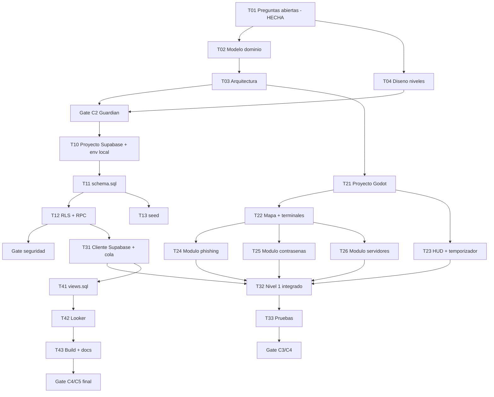

# Plan de Implementación — CyberGuard: Misión Ciberseguridad

> **Fecha:** 2026-10-16
> **Estado:** **Aprobado** — alcance y decisiones fijados por el usuario el 2026-10-16 (sección 8). Alcance inicial: **walking skeleton de 3 días** (§5); el resto es hoja de ruta.
> **Alcance:** Videojuego educativo 2D (Top-Down / Point & Click) sobre buenas prácticas de seguridad digital.
> **Ubicaciones:** este documento es el plan maestro del proyecto. Copia original en `C:\Users\maria\.opencode\plan\cyberguard-plan.md`; copia canónica del proyecto en `doc/plan/00-plan-maestro.md` (ruta esperada por el agente `planeador`).

---

## 1. Resumen ejecutivo

El jugador encarna a un **analista de seguridad** en una empresa ficticia. Contra un **temporizador global**, debe interactuar con **terminales de trabajo** repartidas por la oficina para:

1. **Analizar correos entrantes** y detectar phishing.
2. **Descifrar mensajes encriptados** (mini-juego de cifrado/contraseña).
3. **Reparar servidores infectados** (gestión de vulnerabilidades).

Toda decisión genera **eventos telemétricos** que se envían a **Supabase** (append-only) y se visualizan en **Looker Studio**.

| Aspecto | Decisión |
|---|---|
| Motor | **Godot 4.6** con GDScript tipado (contrato: Godot 4.x; Godot 3.x prohibido) |
| Plataforma | **Web (HTML5) + escritorio (Windows)** — misma base de código; prever CORS/COL en Supabase para Web |
| Estilo visual | Pixel art, resolución base **320×180**, `Texture Filter = Nearest`, assets múltiplos de 16×16 |
| Persistencia | **Supabase (PostgreSQL)** vía HTTP REST (`HTTPRequest`) o addon `godot-supabase` |
| Analítica | **Looker Studio** sobre vistas `v_*` en solo lectura (rol `looker_lectura`); **sin ranking** |
| Idioma | Documentación y comentarios en español |
| Licencias | Solo assets CC0 / CC-BY (con atribución) / propios, registrados en `doc/assets-licencias.md` |

---

## 2. Estado actual del repositorio

- `codigo/game`, `codigo/database`, `codigo/backend`, `doc/`: **vacíos** → no existe proyecto Godot, esquema SQL ni documentación técnica.
- `docs/README.md`: describe arquitectura e intenciones con marcadores `[PENDIENTE: ...]`.
- `agentes/`: documentación contractual de los 13 agentes (roles, gates, entregables).
- `scripts/generar-readme.ps1`: único código funcional.

**Conclusión:** el plan arranca desde cero, respetando el orden de dependencias fijado por `planeador.md` (proyecto Supabase → esquema → backend → juego → vistas → Looker).

---

## 3. Diseño del juego

### 3.1 Bucle de partida

```
Mapa oficina (top-down) → acercarse/clic a terminal → UI de terminal (overlay)
   ├─ Terminal CORREOS: analizar bandeja → marcar phishing / legítimo
   ├─ Terminal CIFRADO: descifrar mensaje (mini-juego)
   └─ Terminal SERVIDORES: localizar y reparar vulnerabilidades
→ Temporizador corre en paralelo → al expirar: resumen + retroalimentación educativa
→ Eventos enviados a Supabase → dashboard Looker
```

### 3.2 Mecánicas por módulo (orden de prioridad: Phishing → Contraseñas → Servidores)

**Módulo A — Análisis de phishing (prioridad 1)**
- Bandeja de correos con remitente, asunto, cuerpo, enlaces y adjuntos.
- Señales a evaluar: dominio sospechoso, urgencia, error de URL, adjunto inesperado, suplantación de marca, saludo genérico.
- El jugador clasifica: `PHISHING` / `LEGÍTIMO` (con opción "investigar enlace" que muestra la URL real expandida).
- Feedback inmediato con explicación educativa de la señal detectada.

**Módulo B — Contraseñas seguras / mensajes encriptados (prioridad 2)**
- Mini-juego de descifrado (César / sustitución simple) que conduce a evaluar la fortaleza de una contraseña.
- Medidor de fortaleza en tiempo real: longitud, mayúsculas/minúsculas, dígitos, símbolos, ausencia de diccionario.
- Enseñanza sobre reutilización de contraseñas y autenticación en dos factores.

**Módulo C — Reparación de servidores (prioridad 3)**
- Lista de servidores con estado (`sano`, `infectado`, `crítico`).
- El jugador identifica la vulnerabilidad (paquete desactualizado, puerto abierto, permisos excesivos) y aplica el parche correcto.
- Si no se repara a tiempo, la infección se propaga (penalización de tiempo/puntos).

**Temporizador**
- Duración global por nivel (5–8 min), con extensión por tarea correcta opcional.
- Al expirar: pantalla de resumen con aciertos/errores por tipo de amenaza y explicación educativa (no solo "game over").

### 3.3 Niveles y progresión *(validado el 2026-10-16)*

| Nivel | Enfoque | Dificultad |
|---|---|---|
| 1 — Onboarding | Tutorial guiado de phishing: 6 correos (los 2 primeros con temporizador pausado como tutorial, los 4 restantes con reloj) | Baja |
| 2 — Bandeja peligrosa | 6 correos + 1 contraseña débil | Media |
| 3 — Servidor comprometido | Reparación + phishing mixto | Media-Alta |
| 4 — Tormenta de amenazas | Todos los módulos + propagación activa | Alta |

> **Decidido:** **4 niveles**, **5–8 min** por nivel. Los objetivos exactos y el detalle por misión se especifican en la T04 (`doc/diseno/01-misiones.md`).

### 3.4 Puntuación *(validado el 2026-10-16)*

- Acierto: +100 · Error: −50 · Tiempo restante: +10/s al final · Bonus sin pistas.
- **Sin ranking ni leaderboard**: solo métricas agregadas en Looker Studio (evita PII y tablas adicionales).
- **El cálculo definitivo se valida en servidor (RPC/Edge Function)**; el cliente nunca es fuente de verdad del `puntaje_total`.

---

## 4. Arquitectura técnica

### 4.1 Estructura del proyecto Godot (`codigo/game/`)

```
codigo/game/
├── project.godot              # 320×180, Nearest, autoloads (Godot 4.6)
├── autoload/                  # GameState, Temporizador, Telemetria, Config
├── scenes/
│   ├── main/menu_principal.tscn
│   ├── mapa/oficina.tscn       # tilemap top-down, navegación, terminales
│   ├── terminales/             # terminal_correos, terminal_cifrado, terminal_servidores
│   ├── ui/hud.tscn, popup_feedback.tscn, resumen_nivel.tscn
│   └── modales/                # carta_email.tscn, medidor_password.tscn, panel_servidor.tscn
├── entities/                   # jugador (CharacterBody2D), terminales (Area2D)
├── systems/                    # lógica phishing, cifrado, servidores, scoring
├── services/                   # supabase_client.gd (HTTPRequest), cola_offline.gd
├── export/                     # presets Web (HTML5) y Windows
└── data/                       # niveles y correos en JSON (no en .tres con secretos)
```

### 4.2 Integración con Supabase

- **Proyecto Supabase por crear (decisión 5a):** se crea en la **T10**; el juego solo usa `SUPABASE_URL` + `SUPABASE_ANON_KEY` desde `.env` local.
- Headers `apikey` + `Authorization: Bearer <anon>`; claves cargadas en **runtime**, nunca en `.tscn`/`.tres`.
- **CORS/COL obligatorio para la versión Web** (decisión 1a): configurar orígenes permitidos en el panel de Supabase durante la T10.
- **Autenticación anónima/alias** (sin PII): `jugador_id uuid` + `alias` seudónimo.
- **Cola offline** con reintentos/backoff: si la red falla, los eventos se encolan localmente y se drenan después.
- RLS: cliente solo `INSERT` en `eventos_phishing` y `eventos_password` (**append-only**, sin UPDATE/DELETE).
- Sin `service_role` en el cliente jamás.

### 4.3 Esquema de datos *(a implementar en `codigo/database/`)*

- `schema.sql`: `jugadores`, `partidas`, `niveles`, `eventos_phishing`, `eventos_password`, `eventos_servidor` (por definir con el Analista de Dominio).
- `rls.sql`: políticas append-only + rol `looker_lectura`.
- `views.sql`: `v_*` con tipos estables (`timestamptz`, `text`, `boolean`, `integer`, `numeric`), sin `jsonb`, sin PII, con campo temporal siempre presente.
- `seed.sql`: datos de prueba.
- `.env.example` con placeholders (`SUPABASE_URL`, `SUPABASE_ANON_KEY`, `SUPABASE_SERVICE_ROLE_KEY`); `.env` en `.gitignore`.
- **Sin tablas de ranking** (decisión 3a): la analítica se limita a métricas agregadas.

### 4.4 Looker Studio (última fase)

- Conexión **solo lectura** a vistas `v_*`.
- Métricas: vulnerabilidades más comunes, tasa de efectividad por nivel, tiempo de respuesta por tipo de amenaza.

---

## 5. Fases y desglose de tareas

> Cada tarea: `id · título · responsable · dependencias · entregable · criterio de aceptación · estimación`.
> Responsables: `constructor` (código), `probador` (tests), `revisor` (QA/conformidad), `diseñador` (contenido), `arquitecto`/`analista-dominio` (diseño), `guardian` (gates).
> Detalle completo en `doc/plan/01-desglose-tareas.md`.

### FASE 0 — Contexto y diseño (Gate C1/C2)
| ID | Tarea | Responsable | Depend. | Entregable | Criterio de aceptación | Est. |
|---|---|---|---|---|---|---|
| T01 | Resolver preguntas abiertas (sección 8) con el usuario | interrogador | — | `doc/contexto/*` ✅ **HECHO 2026-10-16** (decisiones en §8) | Niveles, puntuación y plataforma decididos | 0.5 d |
| T02 | Modelo de dominio (entidades, eventos, métricas) | analista-dominio | T01 | `doc/dominio/*` | Entidades y eventos definidos con granularidad | 0.5 d |
| T03 | Arquitectura Godot + contrato Supabase | arquitecto | T02 | `doc/arquitectura/*` | Estructura de carpetas y servicios definidos | 0.5 d |
| T04 | Diseño de misiones/niveles y guía de estilo pixel art | diseñador | T01 | `doc/diseno/01-misiones.md`, `03-guia-estilo-pixelart.md` | Cada nivel con objetivo, amenazas y puntuación | 1 d |
| T05 | **Gate C2 — veredicto Guardián** | guardian | T03,T04 | `doc/guardian/veredicto-c2-*.md` | Resultado `APROBADO` | 0.25 d |

### FASE 1 — Walking skeleton de datos (crítico)
| ID | Tarea | Responsable | Depend. | Entregable | Criterio de aceptación | Est. |
|---|---|---|---|---|---|---|
| T10 | **Crear proyecto Supabase + credenciales en `.env` local** (decisión 5a) | constructor, usuario | T03 | Proyecto Supabase activo + CORS configurado para Web | `SUPABASE_URL` y `SUPABASE_ANON_KEY` en `.env` local (nunca en repo); orígenes Web permitidos | 0.25 d |
| T11 | `schema.sql` + migraciones | constructor | T10 | `codigo/database/schema.sql` | Tablas con FK NOT NULL y `creado_en` | 0.5 d |
| T12 | `rls.sql` (append-only) + RPC de puntaje | constructor | T11 | `codigo/backend/*`, `rls.sql` | Cliente solo INSERT; puntaje validado en servidor | 0.5 d |
| T13 | `seed.sql` de prueba | constructor | T11 | `codigo/database/seed.sql` | Seed insertable sin errores | 0.25 d |
| T14 | **Gate verificación de seguridad** | guardian | T12 | veredicto | Sin secretos, RLS activo | 0.25 d |

### FASE 2 — Proyecto Godot + terminales
| ID | Tarea | Responsable | Depend. | Entregable | Criterio de aceptación | Est. |
|---|---|---|---|---|---|---|
| T21 | Proyecto Godot base: `project.godot`, autoloads, 320×180/Nearest | constructor | T03 | `codigo/game/project.godot` | Abre sin errores en **Godot 4.6** | 0.5 d |
| T22 | Mapa top-down + jugador + interacción con terminales | constructor | T21 | escenas `mapa/`, `entities/` | Movimiento y apertura de terminal funcionales | 1 d |
| T23 | HUD + temporizador global + pantalla de resumen | constructor | T21 | `ui/hud.tscn`, `resumen_nivel.tscn` | Temporizador expira → resumen con feedback educativo | 0.5 d |
| T24 | **Módulo A: análisis de correos/phishing** | constructor | T22 | `terminal_correos.tscn` | Clasificar 6 correos con feedback y evento registrado | 1.5 d |
| T25 | **Módulo B: contraseñas + descifrado** | constructor | T22 | `terminal_cifrado.tscn`, medidor de fortaleza | Descifrar y evaluar contraseña con feedback | 1 d |
| T26 | **Módulo C: servidores infectados** | constructor | T22 | `terminal_servidores.tscn` | Detectar y reparar vulnerabilidad | 1 d |

### FASE 3 — Telemetría + pruebas
| ID | Tarea | Responsable | Depend. | Entregable | Criterio de aceptación | Est. |
|---|---|---|---|---|---|---|
| T31 | Cliente Supabase + cola offline | constructor | T12, T21 | `services/supabase_client.gd`, `cola_offline.gd` | Evento insertado; cola drena tras corte de red | 1 d |
| T32 | Nivel 1 completo (onboarding) integrado | constructor | T24,T25,T26,T23 | nivel jugable de punta a punta | Partida completa + eventos persistidos | 1 d |
| T33 | Pruebas de lógica educativa (GUT / headless) | probador | T32 | tests en `codigo/game/test/` | Casos phishing/contraseña/servidor verificados | 1 d |
| T34 | Revisión de conformidad + **Gate C3/C4** | revisor, guardian | T33 | `doc/revisores/01-checklist-conformidad.md` | Checklist completo, sin hallazgos ALTA | 0.5 d |

### FASE 4 — Analítica y publicación
| ID | Tarea | Responsable | Depend. | Entregable | Criterio de aceptación | Est. |
|---|---|---|---|---|---|---|
| T41 | `views.sql` (`v_*`) sin PII | constructor | T31 | `codigo/database/views.sql` | Vistas con tipos estables y campo temporal | 0.5 d |
| T42 | Dashboard Looker Studio (rol `looker_lectura`) | constructor | T41 | enlace + capturas | 3 métricas visibles en solo lectura | 0.5 d |
| T43 | `.env.example`, README de instalación, export Web + escritorio | liberador | T42 | `.env.example`, docs, presets | Juego ejecutable en Web y Windows; sin secretos | 0.5 d |
| T44 | **Gate C4/C5 final — veredicto Guardián** | guardian | T43 | veredicto | `APROBADO` antes de publicar | 0.25 d |

**Estimación total orientativa:** ~15 días laborables (hoja de ruta completa).
**Alcance aprobado (3 días, decisión 7a): walking skeleton** → T10 → T11 → T12 → T13 → T21 → T22 → T24 → T31 → T32. El resto (T14, T23, T25–T26, T33–T44) queda como fase posterior.

---

## 6. Mapa de dependencias



**Reglas de secuencia (no negociables):** proyecto Supabase → esquema → backend/RLS → Godot estructura → módulo Phishing → Contraseñas → vistas → Looker. Prohibido paralelizar tareas que tocan el **mismo archivo**.

---

## 7. Estrategia de ramas (GitFlow)

```
main  (producción, builds)
  └── release/x.y  (candidato a publicación)
        └── develop  (integración continua)
              ├── feature/fase1-schema        (T10–T13)
              ├── feature/godot-base          (T21–T23)
              ├── feature/modulo-phishing     (T24)
              ├── feature/modulo-contrasenas  (T25)
              ├── feature/modulo-servidores   (T26)
              ├── feature/telemetria-supabase (T31–T32)
              └── feature/vistas-looker       (T41–T43)
```

Merge: `feature/*` → `develop` → `release/*` → `main`, con verificación del `revisor` y `APROBADO` del `guardian` antes de `release`. Detalle en `doc/plan/04-estrategia-ramas.md`.

---

## 8. Decisiones de alcance (respondidas por el usuario — 2026-10-16)

| # | Pregunta | Decisión | Consecuencia en el plan |
|---|---|---|---|
| 1 | Plataforma | **a) Web (HTML5) + escritorio (Windows)** | CORS/COL en Supabase (T10) y presets de export en ambos formatos (T43) |
| 2 | Niveles y duración | **a) 4 niveles, 5–8 min cada uno** | Tabla de §3.3 validada; detalle en T04 |
| 3 | Puntuación | **a) Solo métricas agregadas en Looker** | Sin ranking ni tablas adicionales; menor riesgo de PII |
| 4 | Versión de motor | **Godot 4.6** (ya instalada por el usuario) | Toda la documentación, pruebas y `project.godot` referencian Godot 4.6 |
| 5 | Proyecto Supabase | **a) No existe; hay que crearlo** | Nueva tarea **T10** (Fase 1): crear proyecto + `.env` local + CORS |
| 6 | Assets | **a) Packs CC0/OpenGameArt + propios** | Registrar cada asset en `doc/assets-licencias.md`; placeholder OK durante el walking skeleton |
| 7 | Alcance temporal | **a) 3 días → walking skeleton** | Ruta crítica T10→T11→T12→T13→T21→T22→T24→T31→T32; el resto es hoja de ruta |

**Preguntas cerradas.** Cualquier cambio de alcance obliga a replanificar y actualizar `doc/plan/tablero.md`.

---

## 9. Riesgos y gotchas

| Riesgo | Impacto | Mitigación |
|---|---|---|
| CORS/COL en Supabase (juego Web confirmado) | Eventos perdidos en navegador | Cola offline + configurar orígenes en el panel durante la T10 |
| Esquema SQL inexistente al primer INSERT | Bloqueante | T10 y Fase 1 antes que cualquier código de red |
| Secretos en el repo | Bloqueo del Guardián (ALTA) | `.env.example` solo placeholders; escaneo en cada gate |
| Looker falla por permisos | Retraso fase final | Crear vistas + rol `looker_lectura` con buffer de tiempo |
| PII de menores | Bloqueo legal | Solo `alias` + `uuid`; vistas anonimizadas |
| Assets sin licencia | Bloqueo publicación | Registrar cada asset en `doc/assets-licencias.md` |
| Contenido educativo incorrecto | Falta de propósito | Validar señales de phishing con fuentes de referencia |
| Alcance de 3 días insuficiente | Retraso | Walking skeleton priorizado; T25–T44 quedan como fase 2 |

---

## 10. Definición de éxito (DoD del proyecto)

- [ ] Juego ejecutable en **Godot 4.6** con los 3 módulos jugables y temporizador.
- [ ] Nivel 1 completo: partida de punta a punta con retroalimentación educativa.
- [ ] Eventos insertados en Supabase (append-only con RLS) y visibles en vistas `v_*`.
- [ ] Dashboard Looker Studio con las 3 métricas en solo lectura y sin PII.
- [ ] Exportación funcionando en **Web y escritorio**.
- [ ] `.env.example` versionado, sin secretos reales, `.env` ignorado.
- [ ] Pruebas automatizadas de la lógica educativa en verde.
- [ ] Veredictos `APROBADO` del Guardián en gates C1-C5.
- [ ] Instrucciones de instalación/ejecución en el README.
- [ ] Todos los assets con licencia registrada.

---

## 11. Próximos pasos inmediatos

1. ~~Usuario responde las preguntas abiertas~~ **Completado 2026-10-16** (decisiones en §8).
2. **Siguiente: T10** — crear proyecto Supabase + `.env` local (+ CORS para Web) y **T11** — `schema.sql`.
3. `@analista-dominio`, `@arquitecto`, `@diseñador` → Gate C2 (T02–T05).
4. `@planeador` mantiene `doc/plan/tablero.md` vivo.
5. Ejecución por fases con `@constructor` → `@probador` → `@revisor` → `@guardian` → `@liberador`.
