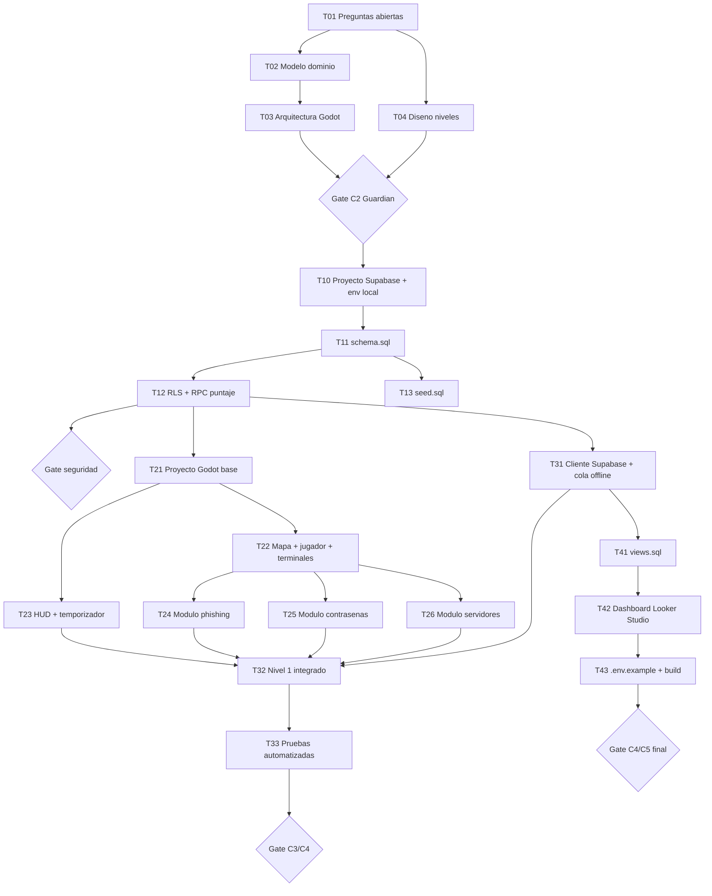

# Mapa de Dependencias — CyberGuard: Misión Ciberseguridad

> **Fuente:** derivado de `doc/plan/00-plan-maestro.md` y `doc/plan/01-desglose-tareas.md`.

---

## 1. Grafo de dependencias (Mermaid `flowchart`)



---

## 2. Cadena crítica (orden no negociable)

```
proyecto Supabase + CORS (T10) ─► schema.sql ─► rls.sql + backend RPC ─► estructura Godot ─► módulo Phishing
        ─► módulo Contraseñas ─► eventos reales en Supabase ─► views.sql ─► Looker Studio
```

> **Alcance vigente (3 días, decisión 7a):** T10 → T11 → T12 → T13 → T21 → T22 → T24 → T31 → T32. Las tareas posteriores (T14, T23, T25–T26, T33–T44) son hoja de ruta.

1. **`codigo/database/schema.sql`** — bloquea backend, eventos y vistas. No puede haber `INSERT` sin esquema.
2. **`codigo/backend` RPC + `rls.sql`** — puntaje e inserción segura; depende del esquema.
3. **`codigo/game` estructura + autoloads + servicios de red** — depende del contrato de arquitectura (T03).
4. **Módulos de juego: primero Phishing (T24), después Contraseñas (T25)** (o en paralelo si hay capacidad y no tocan el mismo archivo).
5. **`codigo/database/views.sql`** — solo posible con datos de los pasos anteriores (T31/T32).
6. **Conexión y publicación de Looker Studio** — al final (T42), tras vistas creadas y rol `looker_lectura`.

---

## 3. Diagrama de Gantt (tareas por día hábil, referencia)

```mermaid
gantt
    title CyberGuard - secuencia de fases
    dateFormat  YYYY-MM-DD
    section Fase 0 Diseno
    T01 Preguntas abiertas        :a1, 1d
    T02 Modelo dominio            :a2, after a1, 1d
    T03 Arquitectura              :a3, after a2, 1d
    T04 Diseno niveles            :a4, after a1, 1d
    T05 Gate C2                   :crit, a5, after a3, 1d
    section Fase 1 Datos
    T10 Proyecto Supabase        :crit, b0, after a5, 1d
    T11 schema.sql                :crit, b1, after b0, 1d
    T12 RLS + RPC                 :crit, b2, after b1, 1d
    T13 seed.sql                  :b3, after b1, 1d
    T14 Gate seguridad            :crit, b4, after b2, 1d
    section Fase 2 Godot
    T21 Proyecto base             :c1, after a3, 1d
    T22 Mapa + terminales         :c2, after c1, 1d
    T23 HUD + temporizador        :c3, after c1, 1d
    T24 Modulo phishing           :c4, after c2, 2d
    T25 Modulo contrasenas        :c5, after c2, 1d
    T26 Modulo servidores         :c6, after c2, 1d
    section Fase 3 Telemetria
    T31 Cliente Supabase          :crit, d1, after b2, 1d
    T32 Nivel 1 integrado         :d2, after c3, 1d
    T33 Pruebas                   :d3, after d2, 1d
    T34 Gate C3/C4                :crit, d4, after d3, 1d
    section Fase 4 Analitica
    T41 views.sql                 :e1, after d1, 1d
    T42 Looker Studio             :e2, after e1, 1d
    T43 Build + docs              :e3, after e2, 1d
    T44 Gate C4/C5                :crit, e4, after e3, 1d
```

---

## 4. Reglas de paralelismo

- **Permitido en paralelo** (archivos distintos): T03 + T04; T13 + T12 (tras T11); T23 + T24/T25/T26; T41 en paralelo con Fase 2 (si T31 ya terminó).
- **Prohibido en paralelo** (mismo archivo): dos tareas sobre `schema.sql`, sobre `terminal_correos.tscn` o sobre `views.sql`.
- **Cuello de botella clave:** T11 (`schema.sql`) y T31 (cliente Supabase) están en la ruta crítica de todas las fases posteriores → priorizarlas.

---

## 5. Verificación

```bash
# El orden esquema → vistas → Looker debe reflejarse en este documento
grep -nE "schema.sql|views.sql|Looker" doc/plan/02-mapa-dependencias.md
```
